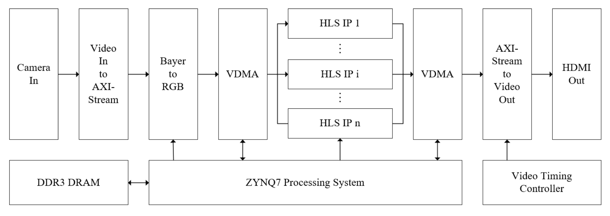

# OV5640 自适应 ISP（PYNQ-Z2）

面向低光/逆光边缘视觉的 FPGA 图像前端：OV5640 采集 → 去马赛克 →
自定义 AXI4-Stream IP（逐像素统计 + 四象限 + 可重构处理）→ VDMA →
HDMI。PS 侧用 MLP 判场景、连续调处理强度，切换落在帧边界，不撕裂。

## 这个作品解决什么问题

固定曝光的摄像头在“窗边逆光”场景里，高光容易饱和、暗部丢细节；
摄像头自带的 AEC/AGC 只能调**全局**亮度，无法同时保住高光和暗部。
本作品把“感知—决策—执行”放在 PL/PS 协同的闭环里：

* **感知**：PL 逐像素统计亮度、亮度平方、梯度，外加四象限亮度；
* **决策**：HLS 3-8-3 Q8.8 MLP 判暗光/逆光/常规；四象限再判“空间是否不均”；
* **执行**：按模式 + 连续 PARAM 做增益/逆光补偿/锐化，参数在帧边界生效。



## 架构

```text
OV5640 -> v_vid_in_axi4s -> v_demosaic
       -> axis_video_proc (statistics + quadrants + MLP handshake + reconfig)
       -> axi_vdma_0 (S2MM) -> DDR
       -> axi_vdma_0 (MM2S) -> axi_vdma_1 (S2MM) -> DDR
       -> axi_vdma_1 (MM2S) -> v_axi4s_vid_out -> rgb2dvi -> HDMI
```

自定义 IP 插在 `v_demosaic_0/m_axis_video` 和 `axi_vdma_0/S_AXIS_S2MM`
之间：这里是整条链路唯一的 24-bit RGB + `tuser/tlast` 原始像素流，
处理结果同时进 Jupyter 抓帧和 HDMI。

## 结果速览

| 项 | 实测 |
|---|---|
| 器件 | PYNQ-Z2 / XC7Z020 |
| 视频 | 1280×720，24-bit RGB，29.61 fps |
| 时序 | stage13 WNS **+0.120 ns**，失败端点 0（stage7 报告 +0.134 ns） |
| 资源 | LUT **29.82%** / FF **19.49%** / BRAM **22.50%** / DSP **26.36%** |
| 3 折留一 | 3 特征 MLP macro-F1 **1.000**；固定亮度阈值 **0.942** |
| 固定 vs 连续 | 常规场景饱和率 **29.4% → 0.4%** |
| Hard pair | 同 `f_luma` 9 vs 8：MLP 都判 0，空间决策 **0 vs 1** |
| Hard pair 逐帧 | 纯 MLP acc 0.750 → 加四象限 **1.000**（逆光 recall 0.500→1.000） |
| 真实场景 | 120 帧，MLP/空间均 **1.000**；scene0 重采为均匀暗场 |
| 失败场景 | 过曝 30/30 置信度拒绝，实际 mode 保持 0 |
| 1 小时 soak | 3600 s / 107,137 帧 / 29.76 fps / 3 次切换 / 无停流 |
| 分屏自洽 | 同帧 RMS **0.09**（<3 判据） |

更细的数字和出处见 `docs/results/`、`docs/08_report_evidence.md`。
**注意**：3 折留一的轮次是从当前 CSV 顺序推断的；上板补采后请用
`data/features.csv` 里的 `round` 列重跑 `tools/eval_rounds.py`。

## 快速开始

### 1）PC / Ubuntu：离线自检（不需要板子）

```bash
cd ai_video_competition
bash run_all.sh test
```

等价于：

```bash
python3 lib/test_regs.py
python3 lib/test_hwh.py
python3 lib/test_spatial.py
python3 tools/offline_check.py --weights /tmp/mlp_weights.h
```

### 2）Ubuntu + Vivado 2024.2：重建 overlay

```bash
source /tools/Xilinx/Vivado/2024.2/settings64.sh
bash build_overlay.sh 13
```

产物会写到 `overlay/cv_ov5640.bit` 和 `overlay/cv_ov5640.hwh`。
阶段说明见 `README_RUN.md`；各阶段验收见 `stageXX_*/VERIFY.md`。

> 比赛推荐 Vivado/Vitis 2026.1 或 2025.2；本工程使用 2024.2。
> `README_2024.2.md` 记录了从 2018.3 迁移到 2024.2 的完整过程、
> 踩过的坑和修法。脚本都带版本检查，换版本时请先读这份文档。

### 3）板子：加载 overlay + 演示

把整个目录拷到板子（例如 `/home/xilinx/jupyter_notebooks/ai_video_competition/`），
按顺序打开：

```text
stage00_baseline/00_baseline_check.ipynb     确认 overlay / IP 清单
stage07_reconfig_array/06_mode_manual.ipynb  手动看三种模式
stage08_auto_schedule/07_auto_schedule.ipynb 自动调度闭环
stage09_perf_test/08_perf_test.ipynb         FPS / 寄存器延迟
stage11_demo/09_demo.ipynb                   答辩演示流程
```

### 4）采数据 / 评估

```bash
# 三类训练数据（阶段 12+ 会写 round + 四象限）
python3 tools/collect_dataset.py

# 数据体检（C1~C8；有 FAIL 不要重训）
python3 tools/check_features.py

# 按采集轮次留出评估（MLP vs 亮度阈值）
python3 tools/eval_rounds.py

# 同亮度、不同空间布局的 hard pair（证明不是纯亮度分类器）
python3 tools/collect_hard_pairs.py
python3 tools/eval_spatial.py --csv data/hard_pairs.csv
```

## 目录对照

比赛推荐 `src/sim/build/board/data/skill/report`；本工程按阶段组织，
对应关系如下（允许其他结构，但要在 README 里说明）：

| 推荐目录 | 本工程位置 |
|---|---|
| `src/` | `stage01..stage13/` 的 `hdl/`、`hls/`、`src/` + `lib/` |
| `sim/` | `stage05_mlp_hls/src/*_tb.cpp`、`tools/offline_check.py`、`lib/test_*.py` |
| `build/` | `build_overlay.sh`、`tools/*.tcl`、`bitstream_2024_2/` |
| `board/` | `stage09..stage13/` 的 notebook、`overlay/`、`weights/` |
| `data/` | `data/` |
| `skill/` | `skill/` |
| `report/` | `report/` + `docs/` |

## 技能包

`skill/` 下有四个不绑定本题的 PYNQ Skill：

* `pynq_overlay_preflight`：overlay/IP/VERSION/VDMA 上板前检查；
* `axil_register_contract`：寄存器表 → Python 封装 + HDL 地址一致性检查；
* `golden_reference_ci`：Python 定点参考 vs HLS/板上输出的逐条比对；
* `vivado_report_gate`：解析 Vivado WNS/TNS 和资源占用，按阈值生成 PASS/FAIL 报告表。

每个 README 都写了适用场景、用法、失效条件、已验证效果、提炼来源和边界。
大模型协作记录见 `report/llm_collaboration.md`。

## 已知限制

* 三分类（暗光/逆光/常规），不是通用场景理解；
* 当前数据 540 帧、3 轮，盒子标定；真实房间泛化仍需补测；
* 四象限只有 4 块，只能检测大范围明暗不均，不能定位小面积高光；
* 720p30（29.6 fps），不是 60 fps；
* 用户已指定约束内 setup/hold/pulse-width 全部通过（WNS +0.120 ns、
  WHS +0.016 ns）；顶层 `vid_pclk` 尚未建立完整输入时钟/I/O 约束，
  methodology 的风险边界见 `docs/results/timing.md`；
* `hard_pairs.csv` 与空间决策阈值需要在板子上按 `docs/09_spatial_decision.md`
  重新标定；报告里不要把模板数字当成实测。

## 许可与致谢

* 本工程新增部分：`axis_video_proc`、`mlp_engine`、PS 侧工具链、文档与 Skill；
* 基础 BD、`rgb2dvi`、OV5640 配置表来自开源工程
  [Pynq-CV-OV5640](https://github.com/xupsh/Pynq-CV-OV5640)（BSD-3-Clause）；
* 许可证见 `LICENSE`，第三方说明见 `THIRD_PARTY_NOTICES.md`。
